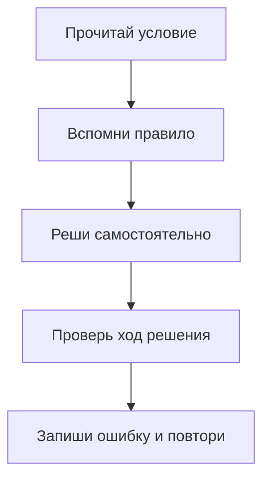

# Урок 08. Вторая четверть — повторение алгоритмов и графов

Цель: восстановить материал первой четверти и найти темы для короткого повторения. Это подготовленный урок; прохождение и освоение ещё не подтверждены.

[[Занятия/Начать занятия|Все уроки]] · [[#Тренировка по шагам|Перейти к заданиям]]

## Как заниматься

Первые 7–10 минут попробуй задания 1–3 без подсказок. Затем прочитай памятку, разбери примеры и реши остальные задания. На весь урок — 45–55 минут. Записывай ход решения до открытия ответа; отмечай, где понадобилась помощь.

## Главное

Функция выполняется при вызове. Параметр — имя в определении, аргумент — переданное значение. return возвращает результат; print выводит его на экран. Индексы списка Python начинаются с нуля. Взвешенный граф хранит длины рёбер; отсутствие ребра отличается от ребра веса ноль. Для количества путей по ориентированному графу без циклов складывают количества путей в предшественники в топологическом порядке.

- Длина пути = сумма весов рёбер
- ways(старт) = 1
- ways(v) = сумма ways(u) по входящим рёбрам u → v

## Разобранные примеры

### Параметр

В def square(n): return n*n и вызове square(5) назови параметр и аргумент.

1. Вспомни правило: Имя в определении и конкретное значение — разные понятия.
2. Решение: n — параметр, 5 — аргумент.
3. Проверь единицы, условия и смысл результата.

### Обязательная вершина

Рёбра AB=2, AC=5, BC=1, BD=6, CD=2, граф неориентированный. Найди кратчайший простой путь A→D через C.

1. Вспомни правило: Сравни прямой вход в C и вход через B.
2. Решение: A-C-D:7; A-B-C-D:2+1+2=5; другие простые пути через C длиннее. Ответ 5.
3. Проверь единицы, условия и смысл результата.

## Наглядная схема



## Тренировка по шагам

### Шаг 1. Безопасность

Пришло письмо со ссылкой для срочной проверки пароля. Что делать?

**Ответ ученика**

_Нажми `Ctrl+E` и замени эту строку своим ходом решения и ответом._

> [!hint]- Подсказка
> Срочность и просьба о пароле — тревожные признаки.

> [!solution]- Правильный ответ к шагу 1
>
> Не открывать подозрительную ссылку и не вводить пароль. Проверить уведомление через самостоятельно открытый официальный сайт, сообщить взрослому.

### Шаг 2. Вызов

Что выведет код?
```python
def f(x):
    return x + 3
print(f(4))
```

**Ответ ученика**

_Нажми `Ctrl+E` и замени эту строку своим ходом решения и ответом._

> [!hint]- Подсказка
> Определение функции само по себе её не вызывает.

> [!solution]- Правильный ответ к шагу 2
>
> При вызове x=4, возвращается 4+3=7, print выводит 7.

### Шаг 3. Параметр

В def square(n): return n*n и вызове square(5) назови параметр и аргумент.

**Ответ ученика**

_Нажми `Ctrl+E` и замени эту строку своим ходом решения и ответом._

> [!hint]- Подсказка
> Имя в определении и конкретное значение — разные понятия.

> [!solution]- Правильный ответ к шагу 3
>
> n — параметр, 5 — аргумент.

### Шаг 4. Возврат

Почему функция с print(x*2), но без return, не подходит для y=f(3)+1?

**Ответ ученика**

_Нажми `Ctrl+E` и замени эту строку своим ходом решения и ответом._

> [!hint]- Подсказка
> Вывод на экран не является возвращаемым числом.

> [!solution]- Правильный ответ к шагу 4
>
> print выводит 6, но функция возвращает None. Сложение None и 1 вызывает TypeError. Нужен return x*2.

### Шаг 5. Индекс

a=[4,7,2,9]. Чему равно a[2]?

**Ответ ученика**

_Нажми `Ctrl+E` и замени эту строку своим ходом решения и ответом._

> [!hint]- Подсказка
> Первый индекс — ноль.

> [!solution]- Правильный ответ к шагу 5
>
> Индексы 0,1,2,3: a[2]=2.

### Шаг 6. Цикл

Найди s после кода.
```python
s=0
for x in [3,8,1,6]:
    if x>4:
        s += x
```

**Ответ ученика**

_Нажми `Ctrl+E` и замени эту строку своим ходом решения и ответом._

> [!hint]- Подсказка
> Суммируются значения, не количество элементов.

> [!solution]- Правильный ответ к шагу 6
>
> Подходят 8 и 6: s=8+6=14.

### Шаг 7. Матрица

В неориентированном графе есть только рёбра A—B веса 4 и B—C веса 3. Заполни матрицу расстояний: порядок A,B,C; диагональ 0; нет ребра — «—».

**Ответ ученика**

_Нажми `Ctrl+E` и замени эту строку своим ходом решения и ответом._

> [!hint]- Подсказка
> Каждое ребро запиши в двух симметричных клетках.

> [!solution]- Правильный ответ к шагу 7
>
> Строки: (0,4,—); (4,0,3); (—,3,0). Матрица симметрична.

### Шаг 8. Длина пути

Неориентированные рёбра AB=4, BC=3, AC=10. Найди кратчайший путь A→C и его длину.

**Ответ ученика**

_Нажми `Ctrl+E` и замени эту строку своим ходом решения и ответом._

> [!hint]- Подсказка
> Меньше рёбер не всегда означает меньшую длину.

> [!solution]- Правильный ответ к шагу 8
>
> Напрямую 10; через B:4+3=7. Кратчайший A-B-C, длина 7.

### Шаг 9. Обязательная вершина

Рёбра AB=2, AC=5, BC=1, BD=6, CD=2, граф неориентированный. Найди кратчайший простой путь A→D через C.

**Ответ ученика**

_Нажми `Ctrl+E` и замени эту строку своим ходом решения и ответом._

> [!hint]- Подсказка
> Сравни прямой вход в C и вход через B.

> [!solution]- Правильный ответ к шагу 9
>
> A-C-D:7; A-B-C-D:2+1+2=5; другие простые пути через C длиннее. Ответ 5.

### Шаг 10. Количество путей

Даны только дуги A→B, A→C, B→D, C→D, B→C. Сколько путей из A в D?

**Ответ ученика**

_Нажми `Ctrl+E` и замени эту строку своим ходом решения и ответом._

> [!hint]- Подсказка
> Обрабатывай A,B,C,D по порядку.

> [!solution]- Правильный ответ к шагу 10
>
> ways(A)=1, B=1, C=1+1=2, D=1+2=3. Пути ABD, ACD, ABCD.

### Шаг 11. Запрет

В том же графе запрещено посещать C. Сколько путей A→D осталось?

**Ответ ученика**

_Нажми `Ctrl+E` и замени эту строку своим ходом решения и ответом._

> [!hint]- Подсказка
> Исключи все пути с запрещённой вершиной.

> [!solution]- Правильный ответ к шагу 11
>
> Удаляем C и её дуги. Остаётся только A-B-D.

### Шаг 12. Выходная проверка

Дуги A→B,A→C,B→C,B→D,C→D,C→E,D→E. Посчитай пути A→E.

**Ответ ученика**

_Нажми `Ctrl+E` и замени эту строку своим ходом решения и ответом._

> [!hint]- Подсказка
> Составь таблицу накопления.

> [!solution]- Правильный ответ к шагу 12
>
> A:1; B:1; C:2; D:1+2=3; E:2+3=5. Это количество путей, а не сумма длин.

## Как оценить результат

Отметь отдельно самостоятельные решения и решения с помощью. 10–12 самостоятельных верных шагов, включая выходную проверку: можно продолжать программу. 7–9: повторить ошибочные типы и дать аналогичное задание через 2–3 дня. 0–6: провести два коротких занятия по пробелам. Это ориентир, а не школьная отметка.

## Вопросы ученика

_Напиши, что осталось непонятным._
