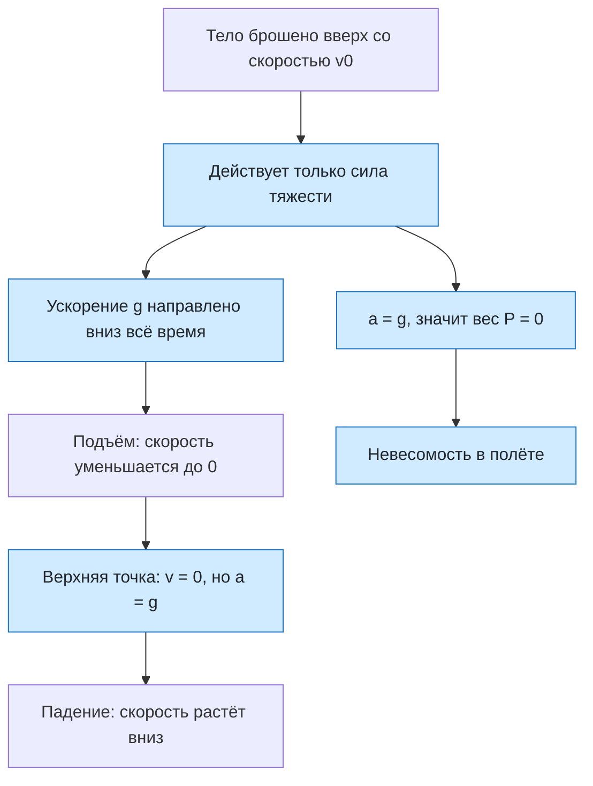

# Урок 13. Бросок вверх и невесомость

Описывать движение тела, брошенного вертикально вверх, находить время подъёма, максимальную высоту, скорость и высоту в любой момент; различать силу тяжести и вес тела; считать вес при движении с ускорением и объяснять, почему в свободном полёте тело находится в состоянии невесомости.

Если не сказано иначе, берём $g=10\ \text{м/с}^2$, сопротивлением воздуха пренебрегаем.

[[Занятия/Начать занятия|Все уроки]] · [[#Тренировка по шагам|Перейти к заданиям]]

## Главное

**Бросок вверх.** После броска на тело действует только сила тяжести. Ускорение всё время равно $g$ и направлено **вниз**: и когда тело летит вверх (замедляясь), и когда падает (разгоняясь), и в самой верхней точке. Направим ось $Oy$ вверх. Тогда проекция ускорения $a_y=-g$, а начальная скорость $v_0>0$:

$$
v=v_0-gt, \qquad h=v_0t-\frac{gt^2}{2}, \qquad v^2=v_0^2-2gh.
$$

Если $v>0$, тело движется вверх, если $v<0$ — вниз. Откуда формулы: это формулы равноускоренного движения $v=v_0+a_yt$, $h=v_0t+\frac{a_yt^2}{2}$ при $a_y=-g$.

**Верхняя точка.** Скорость обращается в ноль: $0=v_0-gt_1$. Время подъёма и наибольшая высота:

$$
t_1=\frac{v_0}{g}, \qquad H=\frac{v_0^2}{2g}.
$$

Высота $H$ получается подстановкой $t_1$ в $h=v_0t-\frac{gt^2}{2}$ или из $0=v_0^2-2gH$. Важно: **в верхней точке скорость равна нулю, а ускорение нет** — оно по-прежнему $g$ вниз. Именно поэтому тело там не остаётся, а начинает падать.

**Симметрия.** Подъём и падение на ту же высоту занимают одинаковое время. Время всего полёта до возвращения в точку броска $t=2t_1=\frac{2v_0}{g}$. На любой высоте скорость при подъёме и при падении одна и та же по модулю, а при возвращении в точку броска скорость по модулю равна $v_0$ и направлена вниз.

**Вес тела.** Сила тяжести $F_{\text{тяж}}=mg$ действует **на тело** со стороны Земли. **Вес** $P$ — сила, с которой тело действует **на опору или подвес** (из-за притяжения к Земле). Это сила упругости (урок 11): весы и динамометр показывают именно вес. По третьему закону Ньютона вес равен по модулю силе реакции опоры $N$ и направлен противоположно.

Если тело вместе с опорой неподвижно или движется равномерно, $P=mg$. Если опора движется с ускорением $a$ по вертикали, то по второму закону Ньютона для тела (ось вверх) $N-mg=ma$, откуда:

$$
P=m(g+a) \ \text{при ускорении вверх}, \qquad P=m(g-a) \ \text{при ускорении вниз}.
$$

При ускорении вверх вес больше $mg$ (**перегрузка**), при ускорении вниз — меньше.

**Невесомость.** Если ускорение направлено вниз и $a=g$, то $P=m(g-g)=0$. Это **невесомость**: тело не давит на опору и не растягивает подвес. Сила тяжести при этом **не исчезает**, она как раз и сообщает ускорение $g$. Невесомость возникает при любом свободном движении, когда на тело действует только сила тяжести: при свободном падении, при полёте тела, брошенного вверх, на всей траектории, и на орбите (станция и космонавт «падают» вокруг Земли с одним и тем же ускорением).

## Наглядная схема

## Тренировка по шагам

Выбери ось вверх, запиши $v_0$ и $a_y=-g$, затем формулу. Проверяй знак скорости: вверх — плюс, вниз — минус.

### Шаг 1. Куда направлено ускорение

Тело брошено вверх. Куда направлено его ускорение на подъёме, в верхней точке и при падении? Каков знак проекции $a_y$, если ось направлена вверх?

**Ответ ученика**

_Не путай направление скорости и направление ускорения._

> [!solution]- Правильный ответ к шагу 1
>
> Во всех трёх случаях ускорение равно $g$ и направлено вниз: действует только сила тяжести. При оси вверх $a_y=-g$. На подъёме скорость направлена вверх, а ускорение вниз, поэтому скорость уменьшается.

### Шаг 2. Верхняя точка

Чему равны скорость и ускорение тела в верхней точке траектории?

**Ответ ученика**

_Разделяй «скорость равна нулю» и «ускорение равно нулю»._

> [!solution]- Правильный ответ к шагу 2
>
> Скорость равна нулю (тело на мгновение останавливается), а ускорение по-прежнему $g=10\ \text{м/с}^2$, направлено вниз. Если бы ускорение было нулём, тело осталось бы в этой точке.

### Шаг 3. Скорость через время

Тело брошено вверх со скоростью 30 м/с. Найди скорость через 1 с и через 4 с. Что означает знак результата?

**Ответ ученика**

_Используй $v=v_0-gt$._

> [!solution]- Правильный ответ к шагу 3
>
> Через 1 с: $v=30-10\cdot1=20$ м/с (вверх). Через 4 с: $v=30-10\cdot4=-10$ м/с. Минус означает, что тело уже движется вниз со скоростью 10 м/с.

### Шаг 4. Время подъёма

Тело брошено вверх со скоростью 20 м/с. Через какое время оно достигнет верхней точки?

**Ответ ученика**

_В верхней точке $v=0$._

> [!solution]- Правильный ответ к шагу 4
>
> $0=v_0-gt_1$, откуда $t_1=\frac{v_0}{g}=\frac{20}{10}=2$ с.

### Шаг 5. Максимальная высота

Тело брошено вверх со скоростью 20 м/с. Найди максимальную высоту подъёма.

**Ответ ученика**

_Можно использовать $H=\frac{v_0^2}{2g}$ или подставить время подъёма._

> [!solution]- Правильный ответ к шагу 5
>
> $H=\frac{v_0^2}{2g}=\frac{20^2}{2\cdot10}=20$ м. Проверка: $h=v_0t_1-\frac{gt_1^2}{2}=20\cdot2-\frac{10\cdot4}{2}=40-20=20$ м.

### Шаг 6. Высота в заданный момент

Тело брошено вверх со скоростью 30 м/с. Найди высоту через 1 с и через 2 с и скорость в эти моменты.

**Ответ ученика**

_Используй $h=v_0t-\frac{gt^2}{2}$ и $v=v_0-gt$._

> [!solution]- Правильный ответ к шагу 6
>
> Через 1 с: $h=30-5=25$ м, $v=20$ м/с. Через 2 с: $h=60-20=40$ м, $v=10$ м/с. Тело поднимается всё медленнее.

### Шаг 7. Время полёта и возвращение

Тело брошено вверх со скоростью 30 м/с. Найди время до возвращения в точку броска и скорость в момент возвращения.

**Ответ ученика**

_Используй симметрию подъёма и падения._

> [!solution]- Правильный ответ к шагу 7
>
> Время подъёма $t_1=\frac{30}{10}=3$ с, всё время полёта $2t_1=6$ с. Скорость при возвращении по модулю равна начальной: 30 м/с, направлена вниз. Проверка: $v=30-10\cdot6=-30$ м/с.

### Шаг 8. Скорость на высоте

Тело брошено вверх со скоростью 30 м/с. Найди модуль скорости на высоте 25 м. Сколько раз тело побывает на этой высоте?

**Ответ ученика**

_Используй $v^2=v_0^2-2gh$ и симметрию._

> [!solution]- Правильный ответ к шагу 8
>
> $v^2=900-2\cdot10\cdot25=400$, $v=20$ м/с. На высоте 25 м тело побывает дважды: при подъёме (через 1 с, скорость 20 м/с вверх) и при падении (через 5 с, скорость 20 м/с вниз). Модули скорости одинаковы.

### Шаг 9. Вес в покое и в лифте

Масса человека 60 кг. Каков его вес в покое? Каков вес в лифте, который разгоняется вверх с ускорением 2 м/с²? А вниз с ускорением 2 м/с²? Прими $g=10\ \text{м/с}^2$.

**Ответ ученика**

_Сначала выясни направление ускорения._

> [!solution]- Правильный ответ к шагу 9
>
> В покое $P=mg=600$ Н. При ускорении вверх $P=m(g+a)=60\cdot12=720$ Н (перегрузка). При ускорении вниз $P=m(g-a)=60\cdot8=480$ Н.

### Шаг 10. Невесомость

Трос лифта оборвался, и лифт падает с ускорением $g$. Каков вес человека массой 60 кг в этом лифте? Исчезла ли сила тяжести?

**Ответ ученика**

_Различай силу тяжести и вес._

> [!solution]- Правильный ответ к шагу 10
>
> $P=m(g-g)=0$: человек в невесомости, не давит на пол. Сила тяжести не исчезла: $F_{\text{тяж}}=mg=600$ Н, именно она сообщает человеку и лифту ускорение $g$.

### Шаг 11. Мяч в полёте

Мяч массой 0,5 кг подбросили вверх. Каков его вес на подъёме, в верхней точке и при падении после того, как он покинул руку? Что можно сказать в момент броска, когда рука разгоняет мяч вверх?

**Ответ ученика**

_Определи ускорение мяча в каждом случае._

> [!solution]- Правильный ответ к шагу 11
>
> После броска на мяч действует только сила тяжести, его ускорение равно $g$: на подъёме, в верхней точке и при падении мяч находится в невесомости, вес равен нулю. Пока рука разгоняет мяч вверх, ускорение направлено вверх и больше $g$, поэтому вес больше $mg$ (перегрузка).

### Шаг 12. Исправь ошибку

Ученик написал: «В верхней точке скорость равна нулю, значит, ускорение тоже равно нулю и сила тяжести не действует». Найди ошибки и объясни правильно.

**Ответ ученика**

_Что сообщает телу ускорение в верхней точке?_

> [!solution]- Правильный ответ к шагу 12
>
> Ошибка в том, что скорость и ускорение связаны не так: скорость равна нулю лишь на мгновение, ускорение же определяется силой. В верхней точке по-прежнему действует сила тяжести, поэтому $a=g$ вниз и тело начинает падать. Вес тела в этот момент равен нулю (невесомость), но сила тяжести не исчезла.

## Как оценить результат

Можно переходить дальше, если не менее 10 из 12 шагов выполнены верно, ученик не путает скорость и ускорение в верхней точке, учитывает знак проекции, использует $t_1=v_0/g$, $H=v_0^2/(2g)$, различает силу тяжести и вес и объясняет невесомость как состояние при ускорении $g$.

## Вопросы ученика

_Напиши, что осталось непонятным._

## Комментарий преподавателя

_Заполняется после проверки работы._

[[Занятия/Физика/Урок 12 - Три закона Ньютона|Предыдущий урок]]
