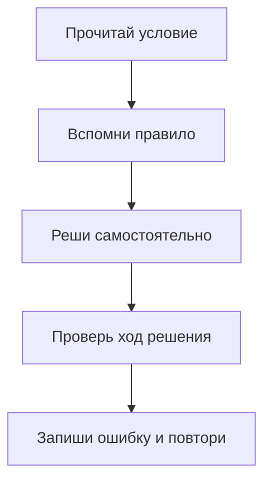

# Урок 14. Вторая четверть — повторение механики

Цель: восстановить материал первой четверти и найти темы для короткого повторения. Это подготовленный урок; прохождение и освоение ещё не подтверждены.

[[Занятия/Начать занятия|Все уроки]] · [[#Тренировка по шагам|Перейти к заданиям]]

## Как заниматься

Первые 7–10 минут попробуй задания 1–3 без подсказок. Затем прочитай памятку, разбери примеры и реши остальные задания. На весь урок — 45–55 минут. Записывай ход решения до открытия ответа; отмечай, где понадобилась помощь.

## Главное

Путь — длина траектории; перемещение соединяет начало и конец. Сначала переведи величины в СИ. Равнодействующая сил определяет ускорение, а не скорость. Силы третьего закона Ньютона приложены к разным телам. При свободном полёте вес равен нулю, сила тяжести сохраняется.

- x = x₀ + vₓt
- aₓ = (vₓ − v₀ₓ)/t
- F = ma
- Fупр = kx
- aц = v²/R
- g = 10 м/с²

## Разобранные примеры

### Координата

x₀=−3 м, vₓ=4 м/с. Найди координату через 5 с.

1. Вспомни правило: Используй начальную координату.
2. Решение: x=−3+4·5=17 м. Путь равен 20 м, это другая величина.
3. Проверь единицы, условия и смысл результата.

### Окружность

v=6 м/с, R=3 м. Найди центростремительное ускорение.

1. Вспомни правило: Постоянный модуль скорости не означает нулевое ускорение.
2. Решение: a=v²/R=36/3=12 м/с², направлено к центру.
3. Проверь единицы, условия и смысл результата.

## Наглядная схема

## Тренировка по шагам

### Шаг 1. Путь и перемещение

Пройдено 6 м вправо и 2 м влево. Найди путь и проекцию перемещения.

**Ответ ученика**

_Нажми `Ctrl+E` и замени эту строку своим ходом решения и ответом._

> [!hint]- Подсказка
> Сложи участки для пути, учти направление для перемещения.

> [!solution]- Правильный ответ к шагу 1
>
> Путь: 6+2=8 м. Перемещение: 6−2=+4 м.

### Шаг 2. Единицы

Переведи 54 км/ч в м/с.

**Ответ ученика**

_Нажми `Ctrl+E` и замени эту строку своим ходом решения и ответом._

> [!hint]- Подсказка
> Раздели на 3,6.

> [!solution]- Правильный ответ к шагу 2
>
> 54/3,6=15 м/с.

### Шаг 3. Координата

x₀=−3 м, vₓ=4 м/с. Найди координату через 5 с.

**Ответ ученика**

_Нажми `Ctrl+E` и замени эту строку своим ходом решения и ответом._

> [!hint]- Подсказка
> Используй начальную координату.

> [!solution]- Правильный ответ к шагу 3
>
> x=−3+4·5=17 м. Путь равен 20 м, это другая величина.

### Шаг 4. График и встреча

Прямая x₁(t) проходит через (0 с; 8 м) и (4 с; 0 м). Второе тело: x₂=2+t. Запиши x₁(t), построй оба графика и найди встречу.

**Ответ ученика**

_Нажми `Ctrl+E` и замени эту строку своим ходом решения и ответом._

> [!hint]- Подсказка
> Наклон графика координаты равен проекции скорости.

> [!solution]- Правильный ответ к шагу 4
>
> v₁=(0−8)/4=−2 м/с. 8−2t=2+t, t=2 с, x=4 м. Построй первые точки (0;8),(4;0), вторые (0;2),(4;6); пересечение (2;4).

### Шаг 5. Ускорение

Скорость вдоль оси выросла с 2 до 14 м/с за 4 с. Найди ускорение.

**Ответ ученика**

_Нажми `Ctrl+E` и замени эту строку своим ходом решения и ответом._

> [!hint]- Подсказка
> Делим изменение скорости на время.

> [!solution]- Правильный ответ к шагу 5
>
> aₓ=(14−2)/4=3 м/с².

### Шаг 6. Второй закон

Тело массой 3 кг испытывает силы 14 Н вправо и 5 Н влево. Найди ускорение, ось вправо.

**Ответ ученика**

_Нажми `Ctrl+E` и замени эту строку своим ходом решения и ответом._

> [!hint]- Подсказка
> Нужна равнодействующая.

> [!solution]- Правильный ответ к шагу 6
>
> Fₓ=14−5=9 Н; aₓ=9/3=3 м/с².

### Шаг 7. Третий закон

Книга лежит на столе. Являются ли сила тяжести книги и сила реакции стола парой третьего закона? Объясни.

**Ответ ученика**

_Нажми `Ctrl+E` и замени эту строку своим ходом решения и ответом._

> [!hint]- Подсказка
> Спроси: на какие тела действуют силы?

> [!solution]- Правильный ответ к шагу 7
>
> Обе силы действуют на книгу. Пара реакции стола на книгу — сила книги на стол; силы пары приложены к разным телам.

### Шаг 8. Упругость

k=200 Н/м, удлинение 3 см. Найди силу упругости.

**Ответ ученика**

_Нажми `Ctrl+E` и замени эту строку своим ходом решения и ответом._

> [!hint]- Подсказка
> Сантиметры переведи в метры.

> [!solution]- Правильный ответ к шагу 8
>
> 3 см=0,03 м; F=200·0,03=6 Н.

### Шаг 9. Окружность

v=6 м/с, R=3 м. Найди центростремительное ускорение.

**Ответ ученика**

_Нажми `Ctrl+E` и замени эту строку своим ходом решения и ответом._

> [!hint]- Подсказка
> Постоянный модуль скорости не означает нулевое ускорение.

> [!solution]- Правильный ответ к шагу 9
>
> a=v²/R=36/3=12 м/с², направлено к центру.

### Шаг 10. Бросок вверх

Мяч брошен вверх с 20 м/с. Найди время подъёма и максимальную высоту. Сопротивлением воздуха пренебречь.

**Ответ ученика**

_Нажми `Ctrl+E` и замени эту строку своим ходом решения и ответом._

> [!hint]- Подсказка
> В верхней точке скорость нулевая, ускорение остаётся.

> [!solution]- Правильный ответ к шагу 10
>
> t=20/10=2 с; H=20²/(2·10)=20 м. В верхней точке v=0, a=10 м/с² вниз.

### Шаг 11. Невесомость

В свободно падающей кабине тело массой 2 кг не касается стен. Найди силу тяжести и вес тела.

**Ответ ученика**

_Нажми `Ctrl+E` и замени эту строку своим ходом решения и ответом._

> [!hint]- Подсказка
> Вес действует на опору или подвес.

> [!solution]- Правильный ответ к шагу 11
>
> Сила тяжести mg=20 Н действует на тело. Опоры и подвеса нет, вес равен 0 Н.

### Шаг 12. Выходная проверка

Тело массой 2 кг из покоя движется под постоянной равнодействующей 8 Н вдоль прямой. Найди скорость и путь за 3 с.

**Ответ ученика**

_Нажми `Ctrl+E` и замени эту строку своим ходом решения и ответом._

> [!hint]- Подсказка
> Сначала найди ускорение.

> [!solution]- Правильный ответ к шагу 12
>
> a=8/2=4 м/с²; v=4·3=12 м/с; s=4·3²/2=18 м.

## Как оценить результат

Отметь отдельно самостоятельные решения и решения с помощью. 10–12 самостоятельных верных шагов, включая выходную проверку: можно продолжать программу. 7–9: повторить ошибочные типы и дать аналогичное задание через 2–3 дня. 0–6: провести два коротких занятия по пробелам. Это ориентир, а не школьная отметка.

## Вопросы ученика

_Напиши, что осталось непонятным._
