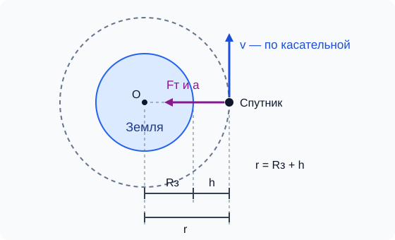

# Урок 18. Искусственные спутники Земли и первая космическая скорость

[[Занятия/Начать занятия|Все уроки]] · [[#Тренировка по шагам|К заданиям]]

## Главное

На вершине выпуклого моста ось направляем вниз. Тогда $mg-N=mv^2/R$, где $R$ — радиус кривизны моста. При $m=3000$ кг, $v=15$ м/с, $R=45$ м и $g=10$ м/с² имеем $a=225/45=5$ м/с² и $N=30\,000-15\,000=15\,000$ Н.

На круговой орбите ускорение тоже направлено к центру. В модели без сопротивления воздуха его создаёт тяготение. Скорость направлена по касательной. Если высота равна $h$, радиус орбиты от центра Земли равен $r=R_\text{З}+h$.

$$\frac{GMm}{r^2}=\frac{mv^2}{r},\qquad v=\sqrt{\frac{GM}{r}},\qquad T=\frac{2\pi r}{v}.$$

Космонавт и корабль свободно падают вместе. Космонавт почти не давит на пол, хотя Земля его притягивает.

## Наглядная схема

## Разобранные примеры

### Первая космическая скорость у поверхности

Из $mg=GMm/R_\text{З}^2$ получаем $g=GM/R_\text{З}^2$, поэтому $v_1=\sqrt{gR_\text{З}}=\sqrt{GM/R_\text{З}}$. Берём $g=9{,}8$ м/с² и $R_\text{З}=6\,400\,000$ м. Тогда $v_1=\sqrt{62\,720\,000}\approx7920$ м/с, или **7,92 км/с**.

Масса Земли $M\approx5{,}97\cdot10^{24}$ кг. При $G\approx6{,}67\cdot10^{-11}$ м³/(кг·с²) получаем $GM\approx3{,}98\cdot10^{14}$ м³/с², или $398\,000$ км³/с². В задачах округляем до $400\,000$ км³/с².

### Скорость и период на высоте 400 км

1. $r=6400+400=6800$ км.
2. $v=\sqrt{400\,000/6800}\approx7{,}67$ км/с.
3. $T=2\pi\cdot6800/v\approx5570$ с, или **93 минуты**.

## Тренировка по шагам

### Шаг 1. Направление скорости

Спутник справа от Земли движется против часовой стрелки. Куда направлена скорость?

**Ответ ученика**

_Нажми `Ctrl+E` и запиши решение._

> [!hint]- Подсказка
> Посмотри на касательную справа.

> [!solution]- Правильный ответ к шагу 1
> Вверх, по касательной к орбите.

### Шаг 2. Сила и ускорение

Куда направлены сила тяготения и ускорение в той же точке?

**Ответ ученика**

_Нажми `Ctrl+E` и запиши решение._

> [!hint]- Подсказка
> Найди центр окружности.

> [!solution]- Правильный ответ к шагу 2
> Влево, к центру Земли.

### Шаг 3. Радиус орбиты

Радиус Земли 6400 км. Спутник на высоте 600 км. Найди радиус орбиты.

**Ответ ученика**

_Нажми `Ctrl+E` и запиши решение._

> [!hint]- Подсказка
> Сложи радиус Земли и высоту.

> [!solution]- Правильный ответ к шагу 3
> r = 6400 + 600 = 7000 км.

### Шаг 4. Первая космическая скорость

Найди скорость для Земли при g = 9,8 м/с² и R = 6400 км.

**Ответ ученика**

_Нажми `Ctrl+E` и запиши решение._

> [!hint]- Подсказка
> Переведи R в метры и извлеки корень из gR.

> [!solution]- Правильный ответ к шагу 4
> √(9,8 · 6 400 000) ≈ 7920 м/с ≈ 7,92 км/с.

### Шаг 5. Скорость спутника

Радиус круговой орбиты 10 000 км, GM = 400 000 км³/с². Найди скорость.

**Ответ ученика**

_Нажми `Ctrl+E` и запиши решение._

> [!hint]- Подсказка
> Используй v = √(GM/r).

> [!solution]- Правильный ответ к шагу 5
> v = √40 ≈ 6,32 км/с.

### Шаг 6. Один оборот

Для орбиты радиусом 10 000 км при v ≈ 6,32 км/с найди период в минутах.

**Ответ ученика**

_Нажми `Ctrl+E` и запиши решение._

> [!hint]- Подсказка
> Раздели 2πr на v, затем раздели секунды на 60.

> [!solution]- Правильный ответ к шагу 6
> T ≈ 9940 с ≈ 166 мин.

### Шаг 7. Сравнение орбит

Радиус круговой орбиты вырос в 4 раза. Как изменились скорость и период?

**Ответ ученика**

_Нажми `Ctrl+E` и запиши решение._

> [!hint]- Подсказка
> Сначала сравни √r, затем длину пути за оборот.

> [!solution]- Правильный ответ к шагу 7
> Скорость уменьшилась вдвое, период вырос в 8 раз.

### Шаг 8. Невесомость

Почему космонавт почти не давит на пол?

**Ответ ученика**

_Нажми `Ctrl+E` и запиши решение._

> [!hint]- Подсказка
> Сравни ускорения корабля и космонавта.

> [!solution]- Правильный ответ к шагу 8
> Космонавт и корабль свободно падают вместе, и сила реакции опоры близка к нулю.
