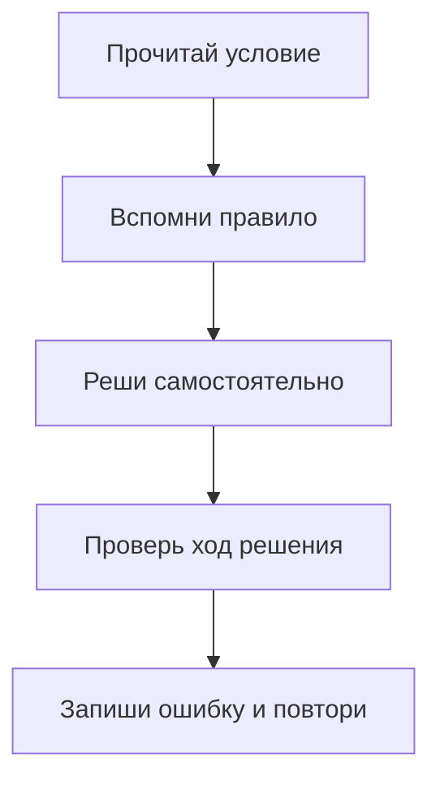

# Урок 06. Вторая четверть — повторение реакций и ОВР

Цель: восстановить материал первой четверти и найти темы для короткого повторения. Это подготовленный урок; прохождение и освоение ещё не подтверждены.

[[Занятия/Начать занятия|Все уроки]] · [[#Тренировка по шагам|Перейти к заданиям]]

## Как заниматься

Первые 7–10 минут попробуй задания 1–3 без подсказок. Затем прочитай памятку, разбери примеры и реши остальные задания. На весь урок — 45–55 минут. Записывай ход решения до открытия ответа; отмечай, где понадобилась помощь.

## Главное

Индекс относится к составу вещества; коэффициент умножает всю формулу. При уравнивании индексы не меняют. Классы неорганических соединений: оксиды, основания, кислоты, соли. Окисление — отдача электронов, восстановление — принятие. Окислитель принимает электроны, восстановитель отдаёт. Равновесие динамическое: скорости прямой и обратной реакций равны.

- Сумма степеней окисления в нейтральном веществе = 0
- В простом веществе степень окисления = 0
- Обычно O: −2; H: +1
- Отдано электронов = принято электронов

## Разобранные примеры

### Классы

Определи классы CaO, NaOH, H₂SO₄, Na₂SO₄.

1. Вспомни правило: Смотри на состав, а не на число атомов.
2. Решение: CaO — оксид; NaOH — основание (щёлочь); H₂SO₄ — кислота; Na₂SO₄ — соль.
3. Проверь единицы, условия и смысл результата.

### Степень окисления

Найди степень окисления S в SO₂ и SO₃.

1. Вспомни правило: Сумма равна нулю.
2. Решение: SO₂: x+2·(−2)=0, x=+4. SO₃: x+3·(−2)=0, x=+6.
3. Проверь единицы, условия и смысл результата.

## Наглядная схема

## Тренировка по шагам

### Шаг 1. Индексы

Сколько атомов Al, S, O обозначает Al₂(SO₄)₃?

**Ответ ученика**

_Нажми `Ctrl+E` и замени эту строку своим ходом решения и ответом._

> [!hint]- Подсказка
> Индекс за скобкой умножает всё внутри.

> [!solution]- Правильный ответ к шагу 1
>
> Al:2, S:1·3=3, O:4·3=12.

### Шаг 2. Коэффициент

Сколько атомов H и O обозначает запись 3H₂O?

**Ответ ученика**

_Нажми `Ctrl+E` и замени эту строку своим ходом решения и ответом._

> [!hint]- Подсказка
> Коэффициент относится и к кислороду.

> [!solution]- Правильный ответ к шагу 2
>
> Коэффициент 3 умножает всю формулу: H=3·2=6, O=3.

### Шаг 3. Классы

Определи классы CaO, NaOH, H₂SO₄, Na₂SO₄.

**Ответ ученика**

_Нажми `Ctrl+E` и замени эту строку своим ходом решения и ответом._

> [!hint]- Подсказка
> Смотри на состав, а не на число атомов.

> [!solution]- Правильный ответ к шагу 3
>
> CaO — оксид; NaOH — основание (щёлочь); H₂SO₄ — кислота; Na₂SO₄ — соль.

### Шаг 4. Коэффициенты

Уравняй Al + O₂ → Al₂O₃. Запиши коэффициенты по порядку.

**Ответ ученика**

_Нажми `Ctrl+E` и замени эту строку своим ходом решения и ответом._

> [!hint]- Подсказка
> Уравняй кислород через НОК 2 и 3.

> [!solution]- Правильный ответ к шагу 4
>
> 4Al+3O₂→2Al₂O₃: слева и справа Al=4, O=6.

### Шаг 5. Тип реакции

Определи тип CaCO₃ → CaO + CO₂ при нагревании.

**Ответ ученика**

_Нажми `Ctrl+E` и замени эту строку своим ходом решения и ответом._

> [!hint]- Подсказка
> Сосчитай вещества до и после.

> [!solution]- Правильный ответ к шагу 5
>
> Из одного сложного вещества образуются два вещества: разложение.

### Шаг 6. Скорость

Почему порошок мела реагирует с кислотой быстрее, чем кусок той же массы, при прочих равных?

**Ответ ученика**

_Нажми `Ctrl+E` и замени эту строку своим ходом решения и ответом._

> [!hint]- Подсказка
> Сравни площадь поверхности.

> [!solution]- Правильный ответ к шагу 6
>
> Больше площадь соприкосновения с раствором, поэтому больше взаимодействий за единицу времени.

### Шаг 7. Равновесие

N₂ + 3H₂ ⇄ 2NH₃ + Q. Куда сместится равновесие при повышении температуры?

**Ответ ученика**

_Нажми `Ctrl+E` и замени эту строку своим ходом решения и ответом._

> [!hint]- Подсказка
> Повышение температуры благоприятствует поглощению теплоты.

> [!solution]- Правильный ответ к шагу 7
>
> Прямая реакция экзотермическая. Нагрев благоприятствует обратной эндотермической реакции — влево.

### Шаг 8. Катализатор

Меняет ли катализатор положение химического равновесия?

**Ответ ученика**

_Нажми `Ctrl+E` и замени эту строку своим ходом решения и ответом._

> [!hint]- Подсказка
> Отдели скорость установления от положения.

> [!solution]- Правильный ответ к шагу 8
>
> Ускоряет прямую и обратную реакции, равновесие устанавливается быстрее, но его положение не меняется.

### Шаг 9. Степень окисления

Найди степень окисления S в SO₂ и SO₃.

**Ответ ученика**

_Нажми `Ctrl+E` и замени эту строку своим ходом решения и ответом._

> [!hint]- Подсказка
> Сумма равна нулю.

> [!solution]- Правильный ответ к шагу 9
>
> SO₂: x+2·(−2)=0, x=+4. SO₃: x+3·(−2)=0, x=+6.

### Шаг 10. Электроны

Fe²⁺ → Fe³⁺: отдаёт или принимает электрон? Как называется процесс?

**Ответ ученика**

_Нажми `Ctrl+E` и замени эту строку своим ходом решения и ответом._

> [!hint]- Подсказка
> Заряд стал на единицу положительнее.

> [!solution]- Правильный ответ к шагу 10
>
> Fe²⁺ − e⁻ → Fe³⁺. Отдача одного электрона — окисление.

### Шаг 11. Окислитель

Zn + CuSO₄ → ZnSO₄ + Cu. Назови восстановитель и частицу-окислитель.

**Ответ ученика**

_Нажми `Ctrl+E` и замени эту строку своим ходом решения и ответом._

> [!hint]- Подсказка
> Названия относятся к исходным частицам.

> [!solution]- Правильный ответ к шагу 11
>
> Zn⁰ отдаёт 2e⁻ и становится Zn²⁺ — восстановитель. Cu²⁺ принимает 2e⁻ — окислитель.

### Шаг 12. Баланс

Уравняй Fe₂O₃ + CO → Fe + CO₂ электронным балансом. Кто окислитель и восстановитель?

**Ответ ученика**

_Нажми `Ctrl+E` и замени эту строку своим ходом решения и ответом._

> [!hint]- Подсказка
> Учитывай два атома Fe в формуле.

> [!solution]- Правильный ответ к шагу 12
>
> 2Fe(+3) принимают 6e⁻; 3C(+2) отдают 6e⁻ и становятся C(+4). Fe₂O₃+3CO→2Fe+3CO₂. Окислитель Fe₂O₃, восстановитель CO. Проверка: Fe=2,C=3,O=6 с обеих сторон.

## Как оценить результат

Отметь отдельно самостоятельные решения и решения с помощью. 10–12 самостоятельных верных шагов, включая выходную проверку: можно продолжать программу. 7–9: повторить ошибочные типы и дать аналогичное задание через 2–3 дня. 0–6: провести два коротких занятия по пробелам. Это ориентир, а не школьная отметка.

## Вопросы ученика

_Напиши, что осталось непонятным._
