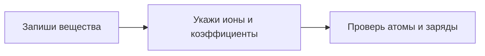

# Урок 08. Реакции ионного обмена и ионные уравнения

[[Занятия/Начать занятия|Все уроки]] · [[#Тренировка по шагам|К заданиям]]

## Главное

Сначала уравняй молекулярное уравнение. Запиши растворимые сильные электролиты ионами, оставь осадок, газ и воду целыми формулами. Сократи одинаковые ионы и проверь атомы и заряд.

## Разобранные примеры

**Осадок.** BaCl₂ + Na₂SO₄ → BaSO₄↓ + 2NaCl.

- Полное: Ba²⁺ + 2Cl⁻ + 2Na⁺ + SO₄²⁻ → BaSO₄↓ + 2Na⁺ + 2Cl⁻.
- Сокращаем 2Na⁺ и 2Cl⁻. Получаем Ba²⁺ + SO₄²⁻ → BaSO₄↓. Заряд слева и справа 0.

**Вода.** HCl + NaOH → NaCl + H₂O. Полное: H⁺ + Cl⁻ + Na⁺ + OH⁻ → Na⁺ + Cl⁻ + H₂O. Сокращаем Na⁺ и Cl⁻, остаётся H⁺ + OH⁻ → H₂O.

**Газ.** При взаимодействии карбоната с кислотой образуется углекислый газ. Сокращённое уравнение CO₃²⁻ + 2H⁺ → CO₂↑ + H₂O. Два H⁺ нужны для сохранения атомов и зарядов.

## Наглядная схема

## Тренировка по шагам

### Шаг 1. Осадок

Какой осадок образуется при смешивании растворов BaCl₂ и Na₂SO₄?

**Ответ ученика**

_Нажми `Ctrl+E` и запиши решение._

> [!hint]- Подсказка
> Сверь сочетания ионов с таблицей растворимости.

> [!solution]- Правильный ответ к шагу 1
> BaSO₄. Сверь сочетания ионов с таблицей растворимости.

### Шаг 2. Ионы-наблюдатели

Какие ионы сокращаются в реакции BaCl₂ с Na₂SO₄?

**Ответ ученика**

_Нажми `Ctrl+E` и запиши решение._

> [!hint]- Подсказка
> Найди частицы, которые остаются в растворе.

> [!solution]- Правильный ответ к шагу 2
> Na⁺ и Cl⁻. Найди частицы, которые остаются в растворе.

### Шаг 3. Осадок хлорида

Какое сокращённое уравнение подходит для AgNO₃ + NaCl?

**Ответ ученика**

_Нажми `Ctrl+E` и запиши решение._

> [!hint]- Подсказка
> В осадок уходит малорастворимый хлорид серебра.

> [!solution]- Правильный ответ к шагу 3
> Ag⁺ + Cl⁻ → AgCl↓. В осадок уходит малорастворимый хлорид серебра.

### Шаг 4. Нейтрализация

Что остаётся после сокращения ионов в реакции HCl + NaOH?

**Ответ ученика**

_Нажми `Ctrl+E` и запиши решение._

> [!hint]- Подсказка
> Na⁺ и Cl⁻ остаются в растворе.

> [!solution]- Правильный ответ к шагу 4
> H⁺ + OH⁻ → H₂O. Na⁺ и Cl⁻ остаются в растворе.

### Шаг 5. Карбонат и кислота

Сколько H⁺ нужно на один CO₃²⁻, чтобы образовались CO₂ и H₂O?

**Ответ ученика**

_Нажми `Ctrl+E` и запиши решение._

> [!hint]- Подсказка
> Сравни заряд слева и справа.

> [!solution]- Правильный ответ к шагу 5
> 2. Сравни заряд слева и справа.

### Шаг 6. Все ионы сократились

Запишется ли сокращённое ионное уравнение при смешивании растворов KCl и NaNO₃?

**Ответ ученика**

_Нажми `Ctrl+E` и запиши решение._

> [!hint]- Подсказка
> Все возможные соли растворимы.

> [!solution]- Правильный ответ к шагу 6
> Нет, все ионы остаются в растворе. Все возможные соли растворимы.

### Шаг 7. Заряд

Каков суммарный заряд слева в Ca²⁺ + CO₃²⁻ → CaCO₃↓?

**Ответ ученика**

_Нажми `Ctrl+E` и запиши решение._

> [!hint]- Подсказка
> Сложи +2 и −2.

> [!solution]- Правильный ответ к шагу 7
> 0. Сложи +2 и −2.

### Шаг 8. Итог

Что оставляют целой формулой в полном ионном уравнении реакции AgNO₃ и NaCl?

**Ответ ученика**

_Нажми `Ctrl+E` и запиши решение._

> [!hint]- Подсказка
> Найди продукт, выпадающий в осадок.

> [!solution]- Правильный ответ к шагу 8
> AgCl↓. Найди продукт, выпадающий в осадок.
