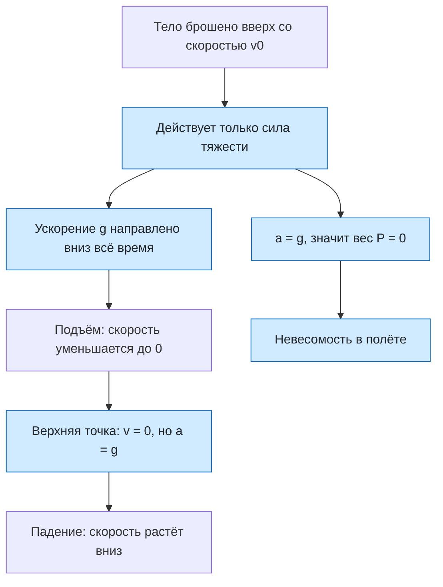

# Урок 13. Движение тела, брошенного вертикально вверх, и невесомость

Статус: подготовлен; занятие ещё не отмечено как проведённое. Время: 45 минут. Нужны тетрадь, ручка и калькулятор; по возможности небольшой мячик, пружинные весы (динамометр) или кухонные весы и груз на нити.

Предыдущие уроки: [[Урок 08 - Свободное падение тел]], [[Урок 11 - Деформация, сила упругости и закон Гука]], [[Урок 12 - Три закона Ньютона]]. Интерактивная практика: [[../Тренажёры/Бросок вверх и невесомость/README|веб-тренажёр «Бросок вверх и невесомость»]].

## Цель и входной уровень

Главный смысл урока: движение тела, брошенного вверх, — свободное движение с ускорением $g$ вниз; в нём тело находится в невесомости, хотя сила тяжести действует. Ученик должен находить время подъёма, наибольшую высоту, скорость и высоту в любой момент, понимать знаки проекций, различать силу тяжести и вес и считать вес при движении с ускорением.

До начала нужно знать свободное падение и формулы $v=gt$, $h=gt^2/2$ (урок 08), второй и третий законы Ньютона (уроки 07, 12), силу упругости и вес как силу, действующую на опору (урок 11). $g=10\ \text{м/с}^2$, сопротивлением воздуха пренебрегаем.

## План на 45 минут

| Этап | Минуты | Действие |
|---|---:|---|
| Вспоминание | 6 | Свободное падение, сила упругости, третий закон |
| Бросок вверх | 12 | Знаки, верхняя точка, время и высота |
| Вес и невесомость | 10 | Вес на опоре, ускорение лифта, $P=0$ |
| Разбор четырёх задач | 7 | Решение вслух с проверкой |
| Практика и тренажёр | 7 | Прогноз времени, высоты и веса |
| Итог | 3 | Выходной вопрос и критерий перехода |

## 1. Разминка

1. Как движется тело, на которое действует только сила тяжести?
2. Чему равно ускорение тела, брошенного вверх, в нижней точке, в верхней точке и при падении?
3. Какая сила действует на подвешенный груз и чем она измеряется на динамометре?
4. Если груз тянет нить вниз с силой 10 Н, с какой силой нить тянет груз?

Не называть «невесомость» заранее. Спросить: «Что показали бы весы, на которых стоишь, если бы пол ушёл вниз с ускорением $g$?»

## 2. Бросок вверх

Ось $Oy$ направлена вверх, $a_y=-g$, $v_0>0$:

$$
v=v_0-gt, \qquad h=v_0t-\frac{gt^2}{2}, \qquad v^2=v_0^2-2gh.
$$

Вывод: общие формулы равноускоренного движения при $a_y=-g$.

**Верхняя точка:** $v=0$, откуда $t_1=v_0/g$ и $H=v_0^2/(2g)$. Скорость равна нулю, ускорение $g$ — не равно. Это главное место, где ученик ошибается.

**Симметрия:** время подъёма равно времени падения до той же точки; на одной высоте скорости по модулю равны; в точку броска тело возвращается через $2v_0/g$ со скоростью $v_0$ вниз.

Графики $v(t)$ — прямая с отрицательным наклоном $-g$, $h(t)$ — парабола с ветвями вниз. Показать, где скорость меняет знак (верхняя точка).

Демонстрация: подбросить мяч, засечь время полёта по секундомеру телефона, вычислить $v_0$ и $H$ по $t=2v_0/g$. Сравнить с оценкой на глаз.

## 3. Вес и невесомость

**Вес** $P$ — сила, с которой тело действует на опору или подвес; **сила тяжести** $mg$ приложена к телу. По третьему закону вес равен силе реакции опоры по модулю.

При ускорении опоры $a$ по вертикали: $N-mg=ma$ (ось вверх), $P=N=m(g+a)$. Если ускорение направлено вниз с модулем $a$, то $P=m(g-a)$.

| Ситуация | Ускорение опоры | Вес |
|---|---|---|
| Покой или равномерное движение | $0$ | $mg$ |
| Лифт разгоняется вверх | $a$ вверх | $m(g+a)$ — перегрузка |
| Лифт разгоняется вниз | $a$ вниз | $m(g-a)$ — вес меньше |
| Свободное падение | $g$ вниз | $0$ — невесомость |

**Невесомость:** $P=0$ при $a=g$. Сила тяжести есть, веса нет: тело и опора движутся с одинаковым ускорением и не давят друг на друга. Тело, брошенное вверх, в полёте невесомо на всей траектории; невесомость на орбите — тоже свободное падение: станция и космонавт движутся с одним ускорением, поэтому не давят друг на друга. Сила тяжести на высоте станции лишь немного меньше, чем у поверхности.

> [!important] Не путай
> Невесомость — это не отсутствие силы тяжести, а отсутствие веса при ускорении $g$.

> [!warning] Частые вопросы
> «Почему в верхней точке мяч не висит?» — потому что ускорение там $g$, а не ноль. «Тяжёлое тело летит выше?» — нет, $H$ не зависит от массы.

## 4. Разобранные задачи

### Разбор 1. Подъём

Тело брошено вверх со скоростью 20 м/с. Найти время подъёма и наибольшую высоту.

**Время:** $t_1=v_0/g=20/10=2$ с. **Высота:** $H=v_0^2/(2g)=400/20=20$ м. **Проверка:** $20\cdot2-10\cdot4/2=20$.

### Разбор 2. Положение и скорость

Тело брошено вверх со скоростью 25 м/с. Найти скорость и высоту через 1, 2, 3 с.

$t=1$: $v=15$ м/с, $h=25-5=20$ м. $t=2$: $v=5$ м/с, $h=50-20=30$ м. $t=3$: $v=-5$ м/с, $h=75-45=30$ м. Тело снова на высоте 30 м, но идёт вниз — симметрия.

### Разбор 3. Лифт

Человек массой 50 кг в лифте. Найти вес в покое, при разгоне вверх с 1 м/с², при разгоне вниз с 1 м/с², при свободном падении лифта.

$P=500$ Н; $50\cdot11=550$ Н; $50\cdot9=450$ Н; $P=0$.

### Разбор 4. Мяч в полёте

Мяч массой 0,4 кг брошен вверх. Каков его вес в полёте? Что происходит в момент разгона рукой?

После броска ускорение $g$ вниз, вес равен нулю. Пока рука разгоняет мяч вверх, ускорение мяча направлено вверх, и вес мяча (давление на руку) равен $m(g+a)$, то есть больше $mg$.

## 5. Практика вместе

1. Тело брошено вверх со скоростью 40 м/с. Найди время подъёма и наибольшую высоту.
2. Найди скорость через 3 с при $v_0=45$ м/с. Куда направлена скорость?
3. С какой скоростью нужно бросить тело вверх, чтобы оно поднялось на 45 м?
4. Через сколько секунд после броска со скоростью 20 м/с тело вернётся в точку броска?
5. Каков вес человека массой 80 кг в лифте, движущемся вверх с ускорением 1,5 м/с²?
6. Объясни, почему космонавты на орбите находятся в невесомости, хотя сила тяжести там почти такая же, как на Земле.

## 6. Самостоятельная работа

За каждое полностью оформленное задание — 1 балл.

1. Тело брошено вверх со скоростью 35 м/с. Найди высоту и скорость через 2 с.
2. Найди время подъёма и наибольшую высоту при $v_0=15$ м/с.
3. Мяч бросили вверх, он вернулся через 4 с. Найди начальную скорость и наибольшую высоту.
4. Человек массой 70 кг стоит на весах в лифте. Что покажут весы (в ньютонах), если лифт разгоняется вниз с ускорением 3 м/с²?
5. Чему равен вес тела в свободном падении и почему сила тяжести при этом не исчезает?
6. Ученик написал: «В верхней точке мяч имеет нулевое ускорение, поэтому он там не падает». Найди ошибку.

## 7. Наглядная схема

## 8. Выходной вопрос и критерий перехода

«Мяч брошен вверх со скоростью 20 м/с. Найди время подъёма и наибольшую высоту. Чему равны скорость и ускорение мяча в верхней точке? Каков вес мяча в полёте?»

Переходить дальше, если не менее 4 из 6 самостоятельных заданий выполнены верно, ученик не говорит, что в верхней точке ускорение равно нулю, правильно использует знак скорости, различает силу тяжести и вес и объясняет невесомость как состояние при ускорении $g$.

## 9. Домашнее задание на 10–15 минут

1. Камень брошен вверх со скоростью 24 м/с. Найди высоту через 1 с и через 3 с и скорость в эти моменты.
2. На какую высоту поднимется тело, брошенное со скоростью 12 м/с? Через сколько секунд вернётся в точку броска?
3. Какая начальная скорость нужна, чтобы тело поднялось на 80 м?
4. Груз массой 3 кг висит на динамометре в лифте, который разгоняется вверх с ускорением 2 м/с². Что покажет динамометр?
5. Объясни, почему прыгун в воду, пока летит с вышки, находится в невесомости, а в момент отталкивания от трамплина его вес больше обычного.

## 10. Ключ для взрослого — после попытки

**Разминка:** 1) с ускорением $g$ вниз; 2) во всех точках $g$ вниз; 3) сила упругости пружины, по динамометру; 4) также 10 Н.

**Вместе:** 1) $t_1=4$ с, $H=80$ м; 2) $v=45-30=15$ м/с, вверх; 3) $v_0=\sqrt{2gH}=\sqrt{900}=30$ м/с; 4) $2v_0/g=4$ с; 5) $P=80\cdot11{,}5=920$ Н; 6) космонавт и станция свободно падают вокруг Земли с одним ускорением и не давят друг на друга.

**Самостоятельно:** 1) $h=70-20=50$ м, $v=35-20=15$ м/с; 2) $t_1=1{,}5$ с, $H=11{,}25$ м; 3) $t_1=2$ с, $v_0=20$ м/с, $H=20$ м; 4) $P=70\cdot7=490$ Н; 5) $P=0$, сила тяжести $mg$ действует и сообщает ускорение $g$; 6) ускорение в верхней точке равно $g$, скорость равна нулю лишь на мгновение.

**Выходной вопрос:** $t_1=2$ с, $H=20$ м; в верхней точке $v=0$, $a=g=10$ м/с² вниз; вес мяча в полёте равен нулю.

**Домашнее:** 1) $t=1$: $h=24-5=19$ м, $v=14$ м/с; $t=3$: $h=72-45=27$ м, $v=-6$ м/с (вниз); 2) $H=7{,}2$ м, время полёта $2{,}4$ с; 3) $v_0=40$ м/с; 4) $P=3\cdot12=36$ Н; 5) в полёте на прыгуна действует только сила тяжести, ускорение $g$, вес равен нулю; при отталкивании трамплин разгоняет прыгуна вверх, ускорение направлено вверх и вес $m(g+a)$ больше $mg$.

## 11. Типичные ошибки и запись результата

| Ошибка | Исправление |
|---|---|
| В верхней точке ускорение равно нулю | Ускорение всё время $g$ вниз |
| Скорость и ускорение направляют одинаково на подъёме | Скорость вверх, ускорение вниз |
| Не учитывают знак скорости | Минус — движение вниз |
| Путают вес и силу тяжести | Вес приложен к опоре, сила тяжести — к телу |
| Говорят, что в невесомости нет силы тяжести | Сила тяжести есть, веса нет |
| Берут $P=m(g-a)$ при ускорении вверх | Вверх — $g+a$, вниз — $g-a$ |

После занятия: дата ___; самостоятельно ___/6; бросок вверх ___; вес в лифте ___; невесомость ___; что повторить ___; следующий шаг ___. Подготовленный урок сам по себе не доказывает освоение темы.
